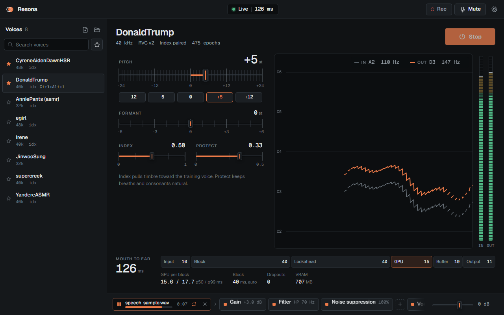

# Resona

A real-time GPU voice changer for RVC v2 voice models, built as a daily driver: low latency, few
artifacts, and an interface that stays out of the way.



**On an RTX 3060 Ti, at a 40 ms block:**
- **Latency:** 144 ms measured mouth-to-output by the built-in self-test, through a virtual cable.
- **GPU time:** 15 ms per block (p50), 16 ms (p99).
- **Stability:** zero dropouts over long runs.

## What it does

- **Voices:** loads RVC v2 `.pth` models (32/40/48 kHz, with or without an `.index`). Import by
  drag-drop, from a folder (for example an old Vonovox `models\` directory) or from `.zip` files.
  The library keeps its own copies.
- **Seamless switching:** move between voices while live with a 50 ms crossfade, by click or by
  hotkey. Up to two favorites stay preloaded on the GPU. Each voice remembers its pitch, formant,
  index and protect settings, plus an optional effect chain of its own.
- **Streaming that matches offline quality:** CUDA-graph inference, a phase-continuous NSF source,
  SOLA crossfades, a GPU resampler that delivers 48 kHz for every voice, and an adaptive jitter
  buffer that trades a few ms for zero dropouts when the GPU spikes.
- **Effects:**
  - *Input chain:* RNNoise noise suppression, filters, a gate.
  - *Output chain:* 5-band EQ with a draggable curve, compressor, de-esser, reverb, chorus, lo-fi.
  - *Always available:* a zero-latency voice gate driven by voice detection, and a true-peak
    limiter, always last.
  - Every control is smoothed, so nothing clicks. Chains can be exported and imported as presets.
- **Singing mode:** one toggle that bypasses noise suppression and the gate, which otherwise
  mangle sustained notes.
- **Sound-file input:** play a WAV, MP3 or FLAC through the voice instead of your mic (play,
  pause, seek, loop). Good for auditioning voices.
- **A/B recorder:** writes your raw input and the converted output as two sample-aligned WAVs to
  `Music\Resona`, so you can compare them or send them to someone.
- **Latency self-test:** measures the real delay with test tones, not an estimate.
- **Daily-driver details:** tray icon, close to tray, start with Windows, global hotkeys (mute,
  push-to-talk, next/previous voice, per-voice keys), monitoring on a second device, and automatic
  recovery from engine crashes and unplugged devices.

## Requirements

- Windows 10 or 11 (64-bit).
- An NVIDIA GPU with a recent driver that supports CUDA 12.8. Developed on an RTX 3060 Ti; a running
  session with one voice uses about 0.5 GB of VRAM.
- A virtual audio cable to route the voice into other apps, such as
  [VB-Cable](https://vb-audio.com/Cable/) (free) or Virtual Audio Cable.
- To build: [uv](https://docs.astral.sh/uv/), [Node.js](https://nodejs.org) LTS and
  [Rust](https://rustup.rs) with the MSVC build tools. Setup downloads about 4 GB in total:
  Python, CUDA PyTorch, and the ContentVec and RMVPE models.

## Install and run

```powershell
git clone <this repo> Resona
cd Resona
powershell -ExecutionPolicy Bypass -File scripts\setup.ps1
```

`setup.ps1` is safe to re-run. It:
- creates the Python engine environment,
- downloads the feature-extractor models,
- builds `target\release\resona.exe`,
- adds **Resona** to the Start Menu (pass `-NoShortcut` to skip this).

After that, start Resona from the Start Menu or by double-clicking **`Resona.cmd`**. The app runs
from the repository folder, because it uses the `engine\` environment next to it, so don't move
the exe on its own.

## First steps

1. **Add voices:** drop `.pth` / `.index` / `.zip` files or a folder onto the window, or use the
   import buttons above the voice list. Indexes are paired automatically.
2. **Pick the devices:** open Settings (gear icon), then Devices. Set **Microphone** to your mic
   and **Output** to the virtual cable's playback side (for example `CABLE Input` for VB-Cable).
3. **In Discord, OBS or a game,** select the cable's recording side (for example `CABLE Output`)
   as the microphone.
4. Press **Start**. On the very first start, Resona measures your GPU for a few seconds and picks
   the smallest block size it can sustain.
5. To hear yourself, turn on **Monitor** in Settings, then Devices, and pick your headphones.

## Using it

| | |
|---|---|
| **Pitch / Formant** | Pitch in semitones (quick buttons for ±5 and ±12). Formant shifts the vocal-tract size without changing pitch. |
| **Index / Protect** | Index pulls the timbre toward the training voice (only for voices with an index). Protect keeps breaths and consonants natural. |
| **Signal strip** (bottom) | Mic → input chain → voice gate → voice → output chain → limiter → output. Click a block to edit it, drag to reorder, click the small lamp to bypass, **+** to add. The ⋯ menu gives the current voice its own chain, or exports and imports presets. |
| **Sound file** | The file icon next to the mic node, or drop an audio file on the window. **×** returns to the microphone. |
| **Rec** (top bar) | Starts an A/B take; press again to save. "Show" opens the take in Explorer. |
| **Latency self-test** | Settings → Performance. Mutes your mic for about 7 s, plays five test tones through everything, and reports the measured delay next to the estimate. Listen on the output (loopback) or on the cable's recording side, which also counts the cable's buffering. |
| **Hotkeys** | Mute `Ctrl+Alt+M`, next/previous voice `Ctrl+Alt+→` / `Ctrl+Alt+←`. Push-to-talk and per-voice keys are set in Settings → Hotkeys and the voice menu. |

**Lowering latency:**
- Use the smallest block that runs without dropouts (Settings → Performance).
- Keep the cable at 48 kHz.
- Try **Low latency** device mode if your driver supports it. Some virtual cables run their clock
  wrong in that mode, which is why it is opt-in.

The latency bar under the pitch trace shows where every millisecond goes.

## Where things are stored

| Path | Contents |
|---|---|
| `%APPDATA%\Resona` | Settings, voice profiles, and the voice library (`voices\<hash>\`). |
| `%LOCALAPPDATA%\Resona\assets` | ContentVec and RMVPE weights. |
| `Music\Resona` | A/B takes (`<date> dry.wav`, `<date> wet.wav`). |

## Troubleshooting

- **"Device did not open within 5 s":** antivirus microphone protection (for example
  Kaspersky's) can hold the device. Allow Resona, or turn that protection off.
- **Robotic or choppy output:**
  - Watch *Dropouts* in the latency bar.
  - Raise the block size, or close GPU-heavy apps.
  - The buffer adapts by itself after a dropout and gives the time back once playback is stable.
- **Dropouts while gaming:**
  - The GPU work per block is set by the context window, not the block size, so a larger block
    alone rarely helps. Lowering **Context** (Settings → Pipeline) does: 500 ms is about half the work.
  - The engine raises its GPU scheduling priority so its short bursts go ahead of the game's frames.
    If the dropout banner says this was refused, start Resona once as administrator.
  - Capping the game's frame rate (in the game or the NVIDIA control panel) leaves the GPU room.
- **Nothing reaches Discord:** check that Resona's Output is the cable's *playback* side and
  Discord's input is its *recording* side. Discord's own noise suppression can also eat converted
  voice; try turning it off.
- **Engine failed:** the status banner shows the engine log. *Copy log* gives you the full text.
  The engine restarts itself up to three times a minute before giving up.

## Development

```text
engine/      Python 3.12: RVC v2 inference (ContentVec, RMVPE/FCPE, synthesizer), streaming
             backend, worker process (JSON-RPC over stdio + shared-memory audio rings)
host/
  shm-ipc/   shared-memory rings and events
  audio-io/  WASAPI capture/render/loopback, 48 kHz mono f32
  dsp/       resampler, SOLA, meters, effects (fx/)
  runtime/   session state machine, real-time pipeline, file player, recorder, self-test
app/         Tauri 2 shell (src-tauri/) and the Svelte 5 UI (src/)
docs/        design spec and implementation plan
```

```powershell
scripts\dev.ps1          # app with hot reload (Vite + debug Rust build)
scripts\dev.ps1 -Mock    # UI only, in the browser, with a mocked backend:
                         #   http://localhost:5173/?state=running&fx&file

cargo test --workspace --release                      # host + app (includes a 20 s soak test)
cd engine; uv run pytest                              # engine (GPU tests run when CUDA is present)
cd app; npm run check                                 # Svelte/TypeScript

# Headless live session (real devices, no UI):
cargo run -p resona-runtime --example live --release -- C:\path\voice.pth "" 30 --out "CABLE Input" --block auto --selftest-at 5

# Offline conversion and quality metrics:
cd engine; uv run resona-engine convert in.wav out.wav --model C:\path\voice.pth --pitch 0 --streaming
```

The design rationale is in [docs/specs/2026-10-24-resona-design.md](docs/specs/2026-10-24-resona-design.md),
and progress against it in [docs/plans/2026-10-24-resona-implementation.md](docs/plans/2026-10-24-resona-implementation.md).

## Status

Milestones M1–M5 are done:
- offline engine,
- real-time host,
- speed,
- full UI,
- effects, sound-file input, A/B recorder and latency self-test.

Not yet built:
- **User-definable filters** (M6): composite filters in TOML with macros, hot-reload, and a
  "Bad Mic" preset.
- **TensorRT engines:** optional. CUDA graphs already meet the latency targets.
- **Installer:** for now Resona runs from the repository folder.

Private project. Third-party components and their licenses are listed in
[THIRD_PARTY.md](THIRD_PARTY.md).
